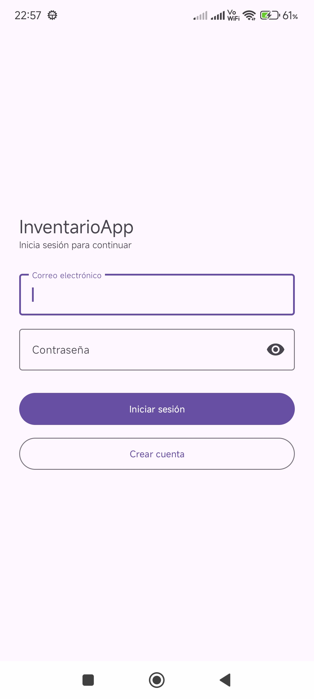
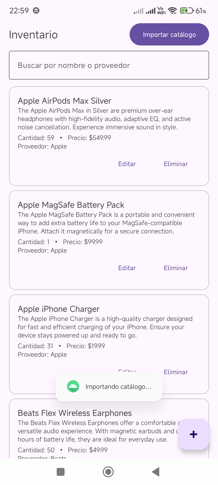
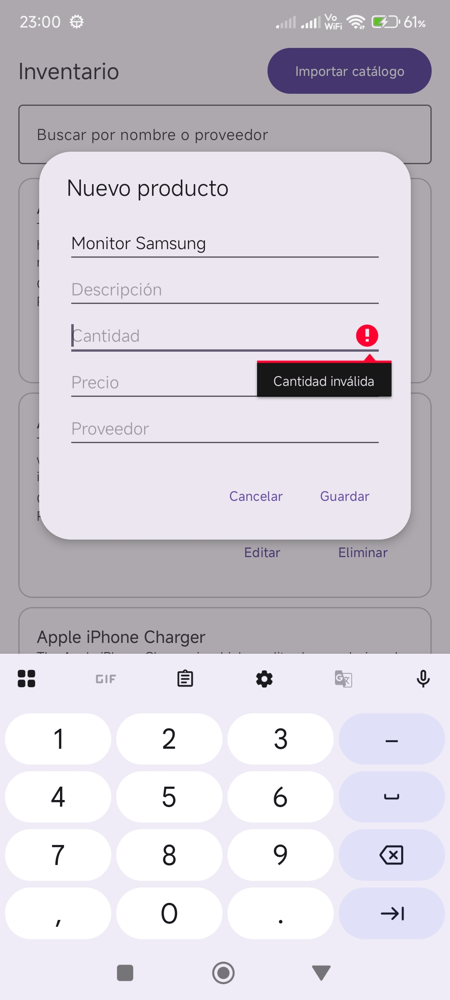

# InventarioApp

Android inventory app built with Kotlin. It works offline first: every change is saved in a local Room database and then synced with Cloud Firestore.

## Features

- Create, edit, delete and search products
- Offline support: data is stored locally in Room and synced with Firestore
- Real-time sync between devices using Firestore snapshot listeners
- Import a product catalog from a REST API (DummyJSON) with Retrofit
- Email and password login with Firebase Authentication

## Screenshots

  
  
  

## Tech stack

- Kotlin, XML views with Material Components
- Room (with KSP) for local storage
- Cloud Firestore for cloud sync
- Retrofit + Gson for REST calls
- Coroutines and Flow
- ViewModel + Repository pattern

## Architecture

`MainActivity` (UI) -> `ProductoViewModel` (UI state) -> `ProductoRepository` -> Room (`ProductoDao`) and Firestore.

## Setup

This repository does not include `google-services.json`. To run the app:

1. Create your own Firebase project and add an Android app with the package name `com.datacore.inventarioapp`.
2. Download `google-services.json` and place it inside the `app/` folder.
3. In the Firebase console, enable **Authentication** with the Email/Password provider.
4. Create a Cloud Firestore database and publish rules that allow access only to authenticated users.

## Status

Work in progress. Planned next: screenshots and unit tests for the ViewModel.